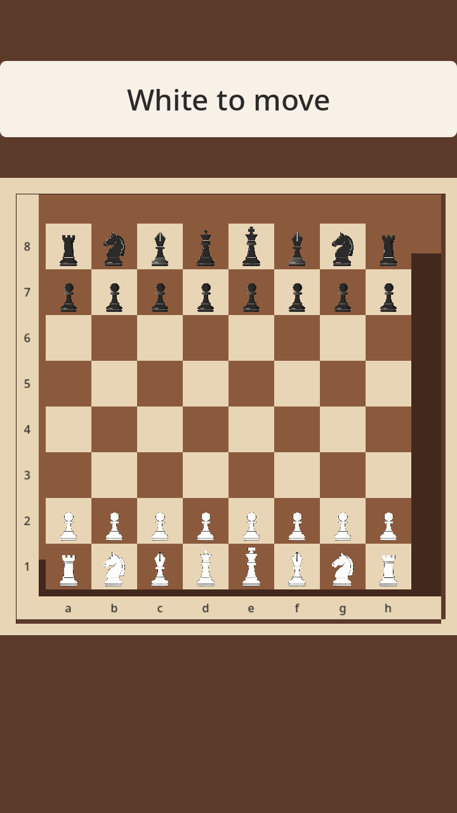
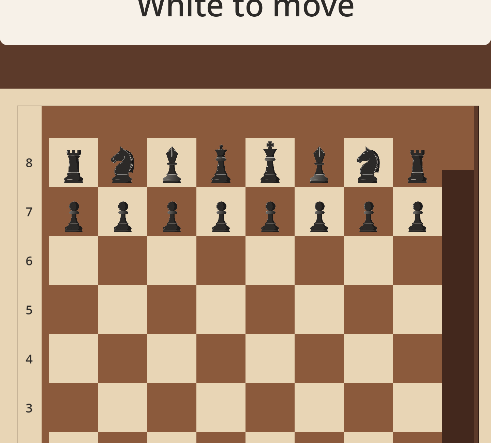
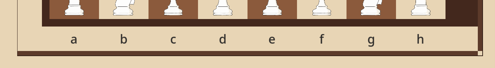

# Result — defect #592 acceptance, graphical re-run (2026-10-24T06:40Z)

Frames and readings. Build, export copy, and commands: [setup.md](setup.md).

## Graphical frames

What the frames show (720×1280, 1 board unit = 56.4 px):

- All 32 pieces are drawn on the opening position; the `White to move` chip and
  the table frame are intact.
- File letters `a`–`h` are dark ink (PAL.C1-family band, PAL.C9-family glyph),
  each over its own file, fully inside the bottom coordinate margin; none of
  them touches the rank-1 squares (the 8×8 ends above the band's top edge).
- Rank digits `1`–`8` sit in the left coordinate margin, each level with its own
  rank; no digit ink enters the a-file (the 8×8 starts right of the band).
- No cream/light label ink remains on the light cafe margin: label ink is dark on
  cream, so the 1.28:1 cream-on-cream failure from the defect report cannot occur
  in this frame.
- `logs/browser.log`: 0 `missing file` / `could not load` asset warnings, 0 page
  errors, 0 failed requests, 0 console errors.

## Related headless evidence

- `docs/playtest/evidence/issue-592/headless-20261023T143000Z/` (PR #599): ink
  box inside the band, README `PER.R7` / D13 rows.
- Verification comment on #592: drawn-band probe (`check_coord_probe.py`) all 16
  boxes inside their bands, `measure_typography()` OK.
