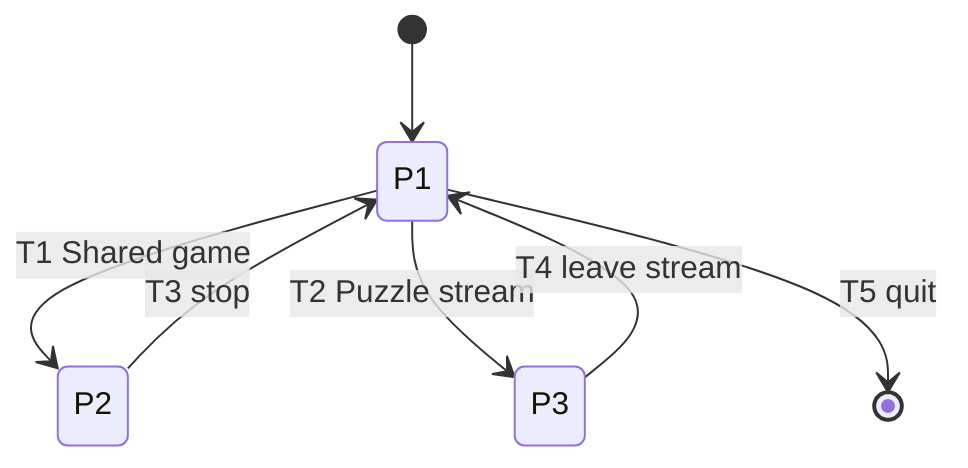

# Flow: Mode pick

Authoring rules: [`.agents/specs/rules/design/flows.md`](../../../.agents/specs/rules/design/flows.md).

- **Scope**: session
- **Parent flow**: None
- **Serves**: Instant play and Cafe calm. Entry to Shared game or Puzzle stream in one session.

## Overview

The player opens the game at mode pick, chooses Shared game or Puzzle stream, plays that mode’s loop, and returns here when they leave the mode. Quitting from mode pick ends the session. A refresh or reopen always returns to mode pick.

## Phases

| ID | Phase | Purpose | What the player can do | Detailed in |
|----|-------|---------|------------------------|-------------|
| P1 | Mode pick | Choose how to play this session | Choose Shared game or Puzzle stream. Quit the session. Unavailable: moving pieces, Advice, clocks | here |
| P2 | Shared game | Two people play on one device | Per the Shared-game loop. Leave only via stop after a result (returns to P1). No direct switch to Puzzle stream | [`loops/two-player-game.md`](../loops/two-player-game.md) |
| P3 | Puzzle stream | Solo adaptive puzzles | Per the puzzle-stream loop. Leave stream returns to P1. No direct switch to Shared game | [`loops/puzzle-stream.md`](../loops/puzzle-stream.md) |

## Transitions

| ID | From | To | Trigger | Conditions | Carries over / resets | Experience intent |
|----|------|----|---------|------------|-----------------------|-------------------|
| T1 | P1 | P2 | Choose Shared game | None | Enter loop K1. Shared-game options set in K1. Store Last mode = Shared game ([PRG.P2](../progression.md)) | Quick start into a friend game |
| T2 | P1 | P3 | Choose Puzzle stream | None | Enter loop K1. [Player Elo](../glossary.md) carried ([PRG.P1](../progression.md)). Store Last mode = Puzzle stream | Straight into matched puzzles |
| T3 | P2 | P1 | Stop after a result ([K3](../loops/two-player-game.md)) | Shared game has ended | Nothing from the game carries | Back to choose again |
| T4 | P3 | P1 | Leave stream ([K4](../loops/puzzle-stream.md)) | Player quits the mode | [Player Elo](../glossary.md) kept; open puzzle not Abandon puzzle | Calm exit without Elo hit |
| T5 | P1 | (end) | Quit session | At mode pick | Session ends; persisted Elo and Last mode remain | Done for now |

## Entry and exit

- **N1**: Flow starts at P1 when the player opens the game. Default choice: Shared game if no Last mode; otherwise the stored Last mode ([PRG.P2](../progression.md)).
- **N2**: Ends via T5 (quit session). Leaving a mode is T3 or T4, not an end of the flow.

## Interruptions

- **U1**: Close, refresh, or reopen during P2 or P3 → next open is P1. [Player Elo](../glossary.md) kept. Open puzzle is not Abandon puzzle. Shared game is not resumed.

## Diagram (optional)

