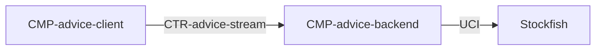

# Component: Advice backend

Authoring rules: [`.agents/specs/rules/technical/components.md`](../../../.agents/specs/rules/technical/components.md).

- **Layer**: Outside client stack (M2 only)
- **Module**: M2 `advice-backend`
- **Serves**: Optional Stockfish Advice; Instant play (client never waits)
- **Informed by**: [F-move-advice](../../design/features/move-advice.md); `CFG.ADVICE_TIME_MS`
- **ADRs**: [ADR-0002](../../adr/decisions/0002-stockfish-advice-backend.md)

## Responsibilities

| ID | Responsibility |
|----|----------------|
| R1 | Be the sole UCI peer to Stockfish |
| R2 | Accept a position from the client and stream eval/best-move |
| R3 | Stop search by `CFG.ADVICE_TIME_MS` (2000) or on client cancel |
| R4 | Never expose Stockfish or UCI endpoints to the browser |

## Communication

| ID | Peer | Direction | Via contract | Notes |
|----|------|-----------|--------------|-------|
| C1 | [`CMP-advice-client`](advice-client.md) | both | [`CTR-advice-stream`](../contracts/advice-stream.md) | Network; provider of stream |
| C2 | Stockfish | both | UCI (internal to M2) | Not a client contract |

## Owns / mutates

| Schema or state | Access |
|-----------------|--------|
| In-flight search / stream session | write |
| [`SCH-advice-update`](../schemata/advice-update.md) payloads | emit |

## Diagram

## Failure / concurrency / persistence

[`failures.md`](../failures.md) T1; [`concurrency.md`](../concurrency.md) U3; [`SEQ-advice-stream`](../sequences/advice-stream.md).
