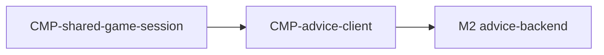

# Component: Advice client

Authoring rules: [`.agents/specs/rules/technical/components.md`](../../../.agents/specs/rules/technical/components.md).

- **Layer**: L4 Edge
- **Module**: M1 `client`
- **Serves**: Optional Stockfish Advice; Instant play
- **Informed by**: [F-move-advice](../../design/features/move-advice.md); `CFG.ADVICE_TIME_MS`
- **ADRs**: [ADR-0002](../../adr/decisions/0002-stockfish-advice-backend.md), [ADR-0010](../../adr/decisions/0010-advice-backend-stack.md)

## Responsibilities

| ID | Responsibility |
|----|----------------|
| R1 | Talk only to advice-backend (M2); never to Stockfish |
| R2 | Request stream for current position when On and online |
| R3 | Apply streamed best-move/eval onto play-state advice fields |
| R4 | Cancel and clear on move, end, Off, offline, or leave Shared |
| R5 | Never block local move apply |
| R6 | Send advice traffic only to the configured endpoint, with the configured API key ([ADR-0010](../../adr/decisions/0010-advice-backend-stack.md)) |
| R7 | Read `T6 advice_time_ms` ([`CFG`](../configuration.md) B3, default 2000) and send it as the `time_ms` of the [`CTR-advice-stream`](../contracts/advice-stream.md) O1 request; the search stop itself is [`CMP-advice-backend`](advice-backend.md) R3 |

## Communication

| ID | Peer | Direction | Via contract | Notes |
|----|------|-----------|--------------|-------|
| C1 | [`CMP-shared-game-session`](shared-game-session.md) | both | [`CTR-advice-stream`](../contracts/advice-stream.md) | Session calls O1–O3 down; E1/E2 up (D5) |
| C2 | [`CMP-advice-backend`](advice-backend.md) | calls | [`CTR-advice-stream`](../contracts/advice-stream.md) | Network stream |

## Owns / mutates

| Schema or state | Access |
|-----------------|--------|
| `GS.adviceBestMove` `GS.adviceEval` (from [`SCH-advice-update`](../schemata/advice-update.md)) | write |
| Position | read only |

## Diagram

## Failure / concurrency / persistence

[`concurrency.md`](../concurrency.md) U3 S1 S2; [`failures.md`](../failures.md) T1 M1.
