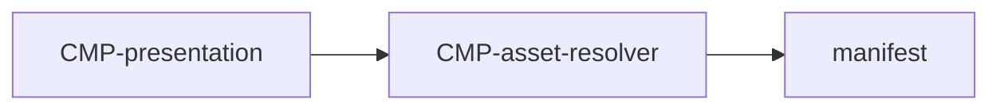

# Component: Asset resolver

Authoring rules: [`.agents/specs/rules/technical/components.md`](../../../.agents/specs/rules/technical/components.md).

- **Layer**: L4 Edge
- **Module**: M1 `client`
- **Serves**: Load time; Instant play; [`ACC`](../../assets/access.md) G1 G2
- **Informed by**: [`asset-access.md`](../asset-access.md); [`specs/assets/access.md`](../../assets/access.md)
- **ADRs**: [ADR-0005](../../adr/decisions/0005-asset-catalog-roots.md), [ADR-0001](../../adr/decisions/0001-godot-engine.md)

## Responsibilities

| ID | Responsibility |
|----|----------------|
| R1 | Read generated asset manifest by asset ID only ([`AST.R1`](../asset-access.md)) |
| R2 | Preload Boot set before mode pick ready ([`AST.G1`](../asset-access.md)) |
| R3 | Preload Play set on first play screen ([`AST.G2`](../asset-access.md)) |
| R4 | Handle unresolved IDs per [`AST.R3`](../asset-access.md) |

## Communication

| ID | Peer | Direction | Via contract | Notes |
|----|------|-----------|--------------|-------|
| C1 | [`CMP-session-router`](session-router.md) | listens | internal | Boot ready |
| C2 | [`CMP-presentation`](presentation.md) | listens | internal | Resolve by ID |

## Owns / mutates

| Schema or state | Access |
|-----------------|--------|
| Loaded resource cache by asset ID | write |
| Manifest | read |

## Diagram

## Failure / concurrency / persistence

[`failures.md`](../failures.md) T4; [`asset-access.md`](../asset-access.md).
