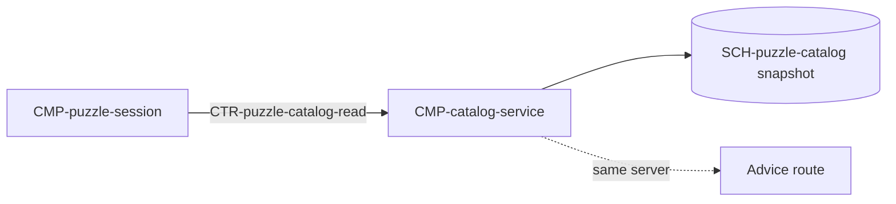

# Component: Catalog service

Authoring rules: [`.agents/specs/rules/technical/components.md`](../../../.agents/specs/rules/technical/components.md).

- **Layer**: Outside client stack (M2 only)
- **Module**: M2 `advice-backend`
- **Serves**: Puzzle stream; [`F-puzzle-catalog`](../../design/features/puzzle-catalog.md) I1 X2; Performance; Reliability
- **Informed by**: [`F-puzzle-catalog`](../../design/features/puzzle-catalog.md); [DIF.Y1](../../design/difficulty.md); [`SCH-puzzle-catalog`](../schemata/puzzle-catalog.md); [configuration](../../design/configuration.md) tunables `CFG.ELO_MATCH_RANGE`, `CFG.ELO_RECENT_WINDOW`, `CFG.ELO_BAND_WIDEN`
- **ADRs**: [ADR-0008](../../adr/decisions/0008-puzzle-catalog-storage.md), [ADR-0010](../../adr/decisions/0010-advice-backend-stack.md), [ADR-0013](../../adr/decisions/0013-puzzle-catalog-api.md), [ADR-0015](../../adr/decisions/0015-advice-backend-operator-deployments.md)

## Responsibilities

| ID | Responsibility |
|----|----------------|
| R1 | Store the ADR-0008 snapshot `2026-10-05` host-side and serve records from it only |
| R2 | Hold the [DIF.Y1](../../design/difficulty.md) candidate policy the client also holds, so the server and [`CMP-puzzle-progression`](puzzle-progression.md) R4 agree on the relax order; it is the same policy table, not a second one |
| R3 | Return exactly one [`SCH-puzzle-catalog`](../schemata/puzzle-catalog.md) F1–F13 record per accepted deal |
| R4 | Accept a deal only when the request key matches the configured advice key (`configuration.md` T10) |
| R5 | Refuse more than 30 deal requests per key per minute ([ADR-0013](../../adr/decisions/0013-puzzle-catalog-api.md)) |
| R6 | Expose no list, page, file, edit, or export operation, and the raw export as no public static file |
| R7 | Keep records and snapshot_id immutable once served (L2–L3); a new snapshot is a new ADR-0008 decision |
| R8 | Be a route on the advice Python server, on that server's host and deploy path, which are the operator's ([ADR-0015](../../adr/decisions/0015-advice-backend-operator-deployments.md)) |
| R9 | Treat a missing T9 or T10 as [`configuration.md`](../configuration.md) `B5`: the unconfigured state, not a project-release fault. A seam build never stands in for an operator-configured deal (ADR-0015) |

## Communication

| ID | Peer | Direction | Via contract | Notes |
|----|------|-----------|--------------|-------|
| C1 | [`CMP-puzzle-session`](puzzle-session.md) | both | [`CTR-puzzle-catalog-read`](../contracts/puzzle-catalog-read.md) | Network; provider of the deal. The session offers each record to [`CMP-puzzle-progression`](puzzle-progression.md) R4, which selects per `DIF.Y1` `Y1` or refuses (`CTR-puzzle-progress` O2) |
| C2 | Advice route on the same server | listens | internal | Same endpoint, key config, and rate accounting scope |

## Owns / mutates

| Schema or state | Access |
|-----------------|--------|
| [`SCH-puzzle-catalog`](../schemata/puzzle-catalog.md) served snapshot | read |
| Per-key request counts in the last minute | write, in memory |

The snapshot is read-only here; no client state is persisted on the server.

## Diagram

## Failure / concurrency / persistence

Any failed read returns no record and the client deals nothing, so `GS.playerElo` stays unchanged ([`failures.md`](../failures.md) Reliability; `F-puzzle-catalog` X2). Request counts are per key and per minute and reset without persistence. The served snapshot persists across restarts on that server's deploy path, which the operator owns (ADR-0015). A missing T9 or T10 is [`configuration.md`](../configuration.md) `B5`.
