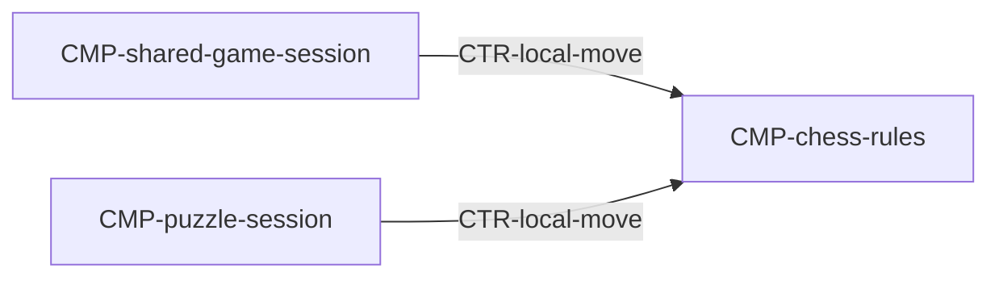

# Component: Chess rules

Authoring rules: [`.agents/specs/rules/technical/components.md`](../../../.agents/specs/rules/technical/components.md).

- **Layer**: L3 Domain
- **Module**: M1 `client`
- **Serves**: Legal moves; check/checkmate; end conditions; Instant play on-device
- **Informed by**: [`E-pieces`](../../design/entities/pieces.md); [`end-conditions`](../../design/end-conditions.md)
- **ADRs**: [ADR-0001](../../adr/decisions/0001-godot-engine.md)

## Responsibilities

| ID | Responsibility |
|----|----------------|
| R1 | Own position legality and side to move |
| R2 | Apply a legal move or reject illegal input |
| R3 | Report check, mate, stalemate, and other design end signals |
| R4 | Support puzzle required-sequence comparison without network |

## Communication

| ID | Peer | Direction | Via contract | Notes |
|----|------|-----------|--------------|-------|
| C1 | [`CMP-shared-game-session`](shared-game-session.md) | listens | [`CTR-local-move`](../contracts/local-move.md) | Provider |
| C2 | [`CMP-puzzle-session`](puzzle-session.md) | listens | [`CTR-local-move`](../contracts/local-move.md) | Provider |

## Owns / mutates

| Schema or state | Access |
|-----------------|--------|
| Position / side / castling-ep fields in [`SCH-play-state`](../schemata/play-state.md) | write |

## Diagram

## Failure / concurrency / persistence

[`concurrency.md`](../concurrency.md) O1; no persistence.
