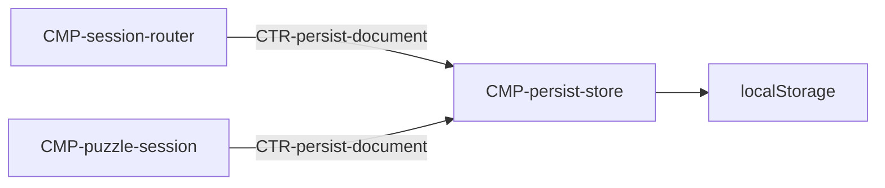

# Component: Persist store

Authoring rules: [`.agents/specs/rules/technical/components.md`](../../../.agents/specs/rules/technical/components.md).

- **Layer**: L4 Edge
- **Module**: M1 `client`
- **Serves**: Save durability; Elo / Last mode / recent solved
- **Informed by**: [`fields-persist`](../../design/game-state/fields-persist.md)
- **ADRs**: [ADR-0003](../../adr/decisions/0003-localstorage-persistence.md)

## Responsibilities

| ID | Responsibility |
|----|----------------|
| R1 | Load whole [`SCH-persist-doc`](../schemata/persist-doc.md) at cold open |
| R2 | Replace whole document on successful commit |
| R3 | On write failure, leave prior document intact and signal failure |
| R4 | Expose committed Elo, Last mode, recentSolved to sessions |

## Communication

| ID | Peer | Direction | Via contract | Notes |
|----|------|-----------|--------------|-------|
| C1 | [`CMP-session-router`](session-router.md) | listens | [`CTR-persist-document`](../contracts/persist-document.md) | Load / Last mode |
| C2 | [`CMP-puzzle-session`](puzzle-session.md) | listens | [`CTR-persist-document`](../contracts/persist-document.md) | Elo / recentSolved commit of [`CMP-puzzle-progression`](puzzle-progression.md) O1 values |

## Owns / mutates

| Schema or state | Access |
|-----------------|--------|
| [`SCH-persist-doc`](../schemata/persist-doc.md) | write |
| Browser `localStorage` key `simplechessv2.persist.v1` | write |

## Diagram

## Failure / concurrency / persistence

[`persistence.md`](../persistence.md); [`failures.md`](../failures.md) T2 T3.
