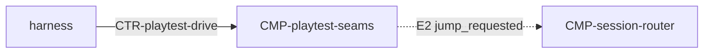

# Component: Playtest seams

Authoring rules: [`.agents/specs/rules/technical/components.md`](../../../.agents/specs/rules/technical/components.md).

- **Layer**: L4 Edge
- **Module**: M1 `client` (playtest builds only)
- **Serves**: Observability; playtest `DBG.*` `TEL.*` `SIT.1`–`SIT.3`; Cafe calm in release
- **Informed by**: [`specs/playtest/tools.md`](../../playtest/tools.md); [`verification.md`](../verification.md)
- **ADRs**: [ADR-0004](../../adr/decisions/0004-dual-playtest-environments.md)

## Responsibilities

| ID | Responsibility |
|----|----------------|
| R1 | Expose pause/resume, inspect, jump, and story-ID overlay (`DBG.1–4`) |
| R2 | Emit telemetry events with `TEL.1–5` fields |
| R3 | Compile or no-op out of public release Web export |
| R4 | Work in both Headless and Graphical playtest runners |
| R5 | Set seed, record and replay input, and dump full state (`SIT.1`–`SIT.3`) on playtest builds only |

## Communication

| ID | Peer | Direction | Via contract | Notes |
|----|------|-----------|--------------|-------|
| C1 | Playtest agent / harness | listens | [`CTR-playtest-drive`](../contracts/playtest-drive.md) | Drive + observe |
| C2 | [`CMP-shared-game-session`](shared-game-session.md), [`CMP-puzzle-session`](puzzle-session.md), [`CMP-presentation`](presentation.md) | listens | [`CTR-local-move`](../contracts/local-move.md), [`CTR-presentation`](../contracts/presentation.md) | Observe play state and story IDs (D6) |

## Owns / mutates

| Schema or state | Access |
|-----------------|--------|
| Pause flag; overlay visibility; seed; input log | write (playtest only) |
| Play state | read via inspect; full dump via `SIT.3` |

## Diagram

## Failure / concurrency / persistence

[`failures.md`](../failures.md) T5; [`verification.md`](../verification.md) S3–S10; [`SEQ-playtest-headless-smoke`](../sequences/playtest-headless-smoke.md).
