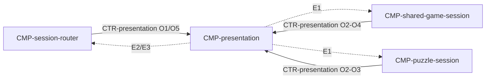

# Component: Presentation

Authoring rules: [`.agents/specs/rules/technical/components.md`](../../../.agents/specs/rules/technical/components.md).

- **Layer**: L1 Presentation
- **Module**: M1 `client`
- **Serves**: Clear board; Cafe calm; touch input; view/UX screens
- **Informed by**: view board camera; UX screens; aesthetics motion/sound
- **ADRs**: [ADR-0001](../../adr/decisions/0001-godot-engine.md), [ADR-0005](../../adr/decisions/0005-asset-catalog-roots.md)

## Responsibilities

| ID | Responsibility |
|----|----------------|
| R1 | Render board, pieces, UI from resolved assets |
| R2 | Capture touch select/move gestures for the active session |
| R3 | Play move/check/mate/resign SFX and cafe ambient when specified |
| R4 | Show Advice highlights/arrow/eval when session supplies them |
| R5 | Never await network before completing piece motion |

## Communication

| ID | Peer | Direction | Via contract | Notes |
|----|------|-----------|--------------|-------|
| C1 | [`CMP-session-router`](session-router.md) | both | [`CTR-presentation`](../contracts/presentation.md) | Screens and asset routing: O1/O5 down; E2/E3 up |
| C2 | [`CMP-shared-game-session`](shared-game-session.md) | both | [`CTR-presentation`](../contracts/presentation.md) | Shared play: O2–O4 down; E1 up |
| C3 | [`CMP-puzzle-session`](puzzle-session.md) | both | [`CTR-presentation`](../contracts/presentation.md) | Puzzle play: O2–O3 down; E1 up |

## Owns / mutates

| Schema or state | Access |
|-----------------|--------|
| Visual selection / animation only | write |
| Play state | read |

## Diagram

## Failure / concurrency / persistence

[`concurrency.md`](../concurrency.md) U1; [`failures.md`](../failures.md) T4; [`asset-access.md`](../asset-access.md).
