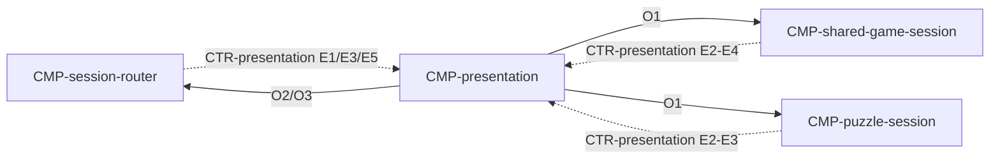

# Component: Presentation

Authoring rules: [`.agents/specs/rules/technical/components.md`](../../../.agents/specs/rules/technical/components.md).

- **Layer**: L1 Presentation
- **Module**: M1 `client`
- **Serves**: Clear board; Cafe calm; touch input; view/UX screens
- **Informed by**: view board camera; UX screens; aesthetics motion/sound
- **ADRs**: [ADR-0001](../../adr/decisions/0001-godot-engine.md), [ADR-0005](../../adr/decisions/0005-asset-catalog-roots.md)

## Responsibilities

| ID | Responsibility |
|----|----------------|
| R1 | Render board, pieces, UI from resolved assets |
| R2 | Capture touch select/move gestures for the active session |
| R3 | Play move/check/mate/resign SFX and cafe ambient when specified |
| R4 | Show Advice highlights/arrow/eval when session supplies them |
| R5 | Never await network before completing piece motion |
| R6 | Resolve player-facing copy through [`CTR-localization`](../contracts/localization.md) O1 for the current `GS.locale`, per [`SCH-string-table`](../schemata/string-table.md) |
| R7 | Keep board state cues non-audio: the checked King carries a [PAL.C8](../../aesthetics/palette.md) rose treatment and side to move stays visible ([PER.R6](../../view/perception.md)), alongside any localized copy |

## Audio architecture

One shared player per category: a single cafe-bed player and a single cue player, each at the mastered unity gain of its category ([SND.L1](../../aesthetics/sound.md) music under SFX, [SND.L2](../../aesthetics/sound.md) sound effects above the bed, no ducking of moves). Beds hand off M1 → M2 → M1 as a hard playlist join with no crossfade ([SND.M1](../../aesthetics/sound.md)–[SND.M2](../../aesthetics/sound.md)), so a bed change never opens a second music path (assumption A2, PO-confirmed on #767).

## Communication

| ID | Peer | Direction | Via contract | Notes |
|----|------|-----------|--------------|-------|
| C1 | [`CMP-session-router`](session-router.md) | both | [`CTR-presentation`](../contracts/presentation.md) | Screens, cues/ambient, assets: E1/E3/E5 down; O2/O3 up. Reads the locale string table ([`configuration.md`](../configuration.md) B4) |
| C2 | [`CMP-shared-game-session`](shared-game-session.md) | both | [`CTR-presentation`](../contracts/presentation.md) | Shared play: O1 up; E2–E4 down |
| C3 | [`CMP-puzzle-session`](puzzle-session.md) | both | [`CTR-presentation`](../contracts/presentation.md) | Puzzle play: O1 up; E2–E3 down |

## Owns / mutates

| Schema or state | Access |
|-----------------|--------|
| Visual selection / animation only | write |
| Play state | read |

## Diagram

## Failure / concurrency / persistence

[`concurrency.md`](../concurrency.md) U1; [`failures.md`](../failures.md) T4, T13; [`asset-access.md`](../asset-access.md).
