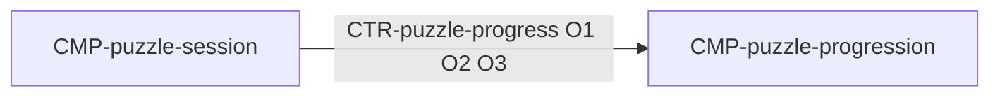

# Component: Puzzle progression

Authoring rules: [`.agents/specs/rules/technical/components.md`](../../../.agents/specs/rules/technical/components.md).

- **Layer**: L3 Domain
- **Module**: M1 `client`
- **Serves**: Puzzle stream; Elo progression; recent solved
- **Informed by**: [`L-puzzle-stream`](../../design/loops/puzzle-stream.md); [`F-puzzle-catalog`](../../design/features/puzzle-catalog.md); [DIF](../../design/difficulty.md) `Y1`; [PRG](../../design/progression.md) `A1` `P1` `P3` `M1`; [`CFG.ELO_K`](../../design/configuration.md), `CFG.ELO_RECENT_WINDOW`
- **ADRs**: [ADR-0001](../../adr/decisions/0001-godot-engine.md), [ADR-0006](../../adr/decisions/0006-layered-client-architecture.md)

## Responsibilities

| ID | Responsibility |
|----|----------------|
| R1 | Compute [`GS.playerElo`](../../design/game-state/fields-persist.md) after a scored outcome per [`DIF.Y1`](../../design/difficulty.md) `Y1` (`S = 1` for `END.W1`; `S = 0` for `END.L4`, `END.L5`, `END.L6`), binding `CFG.ELO_K`; no cap |
| R2 | Produce the next [`GS.recentSolved`](../../design/game-state/fields-persist.md) per [`PRG.P3`](../../design/progression.md) and [`PRG.M1`](../../design/progression.md): append the solved id on `END.W1`, trim to `CFG.ELO_RECENT_WINDOW`; unchanged on a fail |
| R3 | Hold the values it returns between commit and the next entry: `GS.playerElo` and `GS.recentSolved` are Domain-owned with one writer ([`LAY.D2`](../layers.md)) |
| R4 | Select the next puzzle from the record the host returned per `DIF.Y1` `Y1`: in-band, outside the recent window, then widen the band before allowing a recent id and widen again, until one candidate exists; the record is dealt only when it is a member, else it is a refusal. The host returns one record, never a candidate set ([`CTR-puzzle-catalog-read`](../contracts/puzzle-catalog-read.md) G2) |
| R5 | Compute a puzzle's required sequence from the record's `moves` and first opponent move, and judge a played move against it, for the session that owns the attempt |

## Communication

| ID | Peer | Direction | Via contract | Notes |
|----|------|-----------|--------------|-------|
| C1 | [`CMP-puzzle-session`](puzzle-session.md) | listens | [`CTR-puzzle-progress`](../contracts/puzzle-progress.md) | O1 outcome, O2 pick, O3 sequence; Domain provider, session consumer. Owns the `DIF.Y1` arithmetic (R1), the recent-solved list (R2), the pick rung order (R4), and the required sequence (R5) |

Domain calls no L4 peer: the session commits the values R1–R2 return ([`LAY.D1`](../layers.md)).

## Owns / mutates

| Schema or state | Access |
|-----------------|--------|
| `GS.playerElo`, `GS.recentSolved` | write (sole writer, [`CON.O6`](../concurrency.md)) |
| [`SCH-puzzle-attempt`](../schemata/puzzle-attempt.md) required sequence and outcome | compute; the owning session writes them |

## Diagram

## Failure / concurrency / persistence

[`concurrency.md`](../concurrency.md) O6; no persistence — [`persistence.md`](../persistence.md) `M2` `M4` commit what this component returns. A non-selecting deal keeps the current values ([`FAIL.T14`](../failures.md)).
