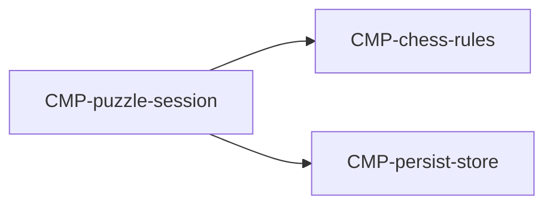

# Component: Puzzle session

Authoring rules: [`.agents/specs/rules/technical/components.md`](../../../.agents/specs/rules/technical/components.md).

- **Layer**: L2 Session
- **Module**: M1 `client`
- **Serves**: Puzzle stream; Elo progression; recent solved
- **Informed by**: [`L-puzzle-stream`](../../design/loops/puzzle-stream.md); [DIF](../../design/difficulty.md); [PRG](../../design/progression.md)
- **ADRs**: [ADR-0001](../../adr/decisions/0001-godot-engine.md), [ADR-0003](../../adr/decisions/0003-localstorage-persistence.md)

## Responsibilities

| ID | Responsibility |
|----|----------------|
| R1 | Deal next puzzle from Elo band and recent history |
| R2 | Accept puzzle moves via chess-rules; detect solve vs wrong move |
| R3 | On result, update Elo and recentSolved; commit via persist |
| R4 | Never enable Advice |

## Communication

| ID | Peer | Direction | Via contract | Notes |
|----|------|-----------|--------------|-------|
| C1 | [`CMP-chess-rules`](chess-rules.md) | calls | [`CTR-local-move`](../contracts/local-move.md) | Puzzle sequence checks |
| C2 | [`CMP-presentation`](presentation.md) | both | internal | Board and feedback |
| C3 | [`CMP-persist-store`](persist-store.md) | calls | [`CTR-persist-document`](../contracts/persist-document.md) | Elo / recentSolved commit |
| C4 | [`CMP-session-router`](session-router.md) | listens | internal | Enter / leave stream |

## Owns / mutates

| Schema or state | Access |
|-----------------|--------|
| [`SCH-puzzle-attempt`](../schemata/puzzle-attempt.md) | write |
| `GS.playerElo` `GS.recentSolved` (via persist) | write on result |

## Diagram

## Failure / concurrency / persistence

[`persistence.md`](../persistence.md) M2 M4; [`failures.md`](../failures.md) T2 M2; [`SEQ-puzzle-result-commit`](../sequences/puzzle-result-commit.md).
