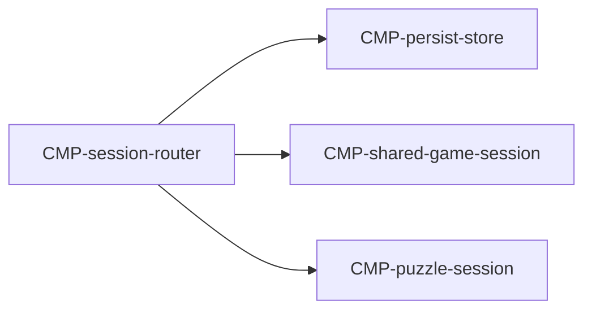

# Component: Session router

Authoring rules: [`.agents/specs/rules/technical/components.md`](../../../.agents/specs/rules/technical/components.md).

- **Layer**: L2 Session
- **Module**: M1 `client`
- **Serves**: Mode pick; Last mode; cold open to playable board
- **Informed by**: UX mode-pick; [`GS.lastMode`](../../design/game-state/fields-persist.md); Load time
- **ADRs**: [ADR-0001](../../adr/decisions/0001-godot-engine.md), [ADR-0003](../../adr/decisions/0003-localstorage-persistence.md)

## Responsibilities

| ID | Responsibility |
|----|----------------|
| R1 | After Boot assets and persist load, show mode pick |
| R2 | Start Shared or Puzzle session from mode pick |
| R3 | Commit Last mode via persist when a mode is entered |
| R4 | Return to mode pick after Shared result or when leaving Puzzle |

## Communication

| ID | Peer | Direction | Via contract | Notes |
|----|------|-----------|--------------|-------|
| C1 | [`CMP-persist-store`](persist-store.md) | calls | [`CTR-persist-document`](../contracts/persist-document.md) | Load Elo/Last mode; write Last mode |
| C2 | [`CMP-shared-game-session`](shared-game-session.md) | calls | internal | Start / tear down Shared |
| C3 | [`CMP-puzzle-session`](puzzle-session.md) | calls | internal | Start / tear down Puzzle |
| C4 | [`CMP-presentation`](presentation.md) | both | internal | Mode-pick and navigation screens |
| C5 | [`CMP-asset-resolver`](asset-resolver.md) | calls | internal | Ensure Boot group before ready |

## Owns / mutates

| Schema or state | Access |
|-----------------|--------|
| Navigation / active mode | write |
| `GS.lastMode` (via persist) | write on enter |

## Diagram

## Failure / concurrency / persistence

[`failures.md`](../failures.md) T3; [`persistence.md`](../persistence.md) M1 M3; [`sequences/cold-open.md`](../sequences/cold-open.md).
