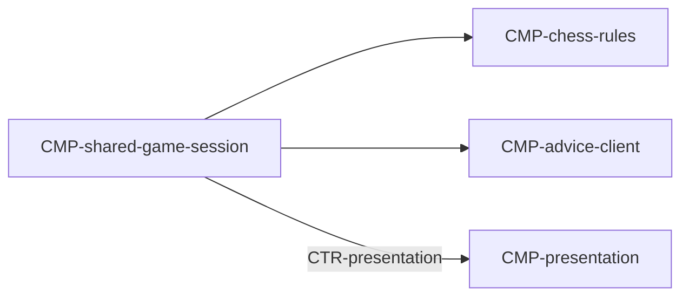

# Component: Shared game session

Authoring rules: [`.agents/specs/rules/technical/components.md`](../../../.agents/specs/rules/technical/components.md).

- **Layer**: L2 Session
- **Module**: M1 `client`
- **Serves**: Shared game loop; clocks; Advice option; end conditions
- **Informed by**: [`L-two-player-game`](../../design/loops/two-player-game.md); [F-move-advice](../../design/features/move-advice.md); end-conditions
- **ADRs**: [ADR-0001](../../adr/decisions/0001-godot-engine.md), [ADR-0002](../../adr/decisions/0002-stockfish-advice-backend.md)

## Responsibilities

| ID | Responsibility |
|----|----------------|
| R1 | Hold Shared setup (seats, clock, increment, Advice) until start, then lock seat/clock/increment |
| R2 | Orchestrate legal moves via chess-rules and presentation |
| R3 | Run side-to-move clocks when timed; apply the increment after a completed move only when that clock has not reached zero (a flagged clock receives none) |
| R4 | Start/stop Advice client per On/online/move/end |
| R5 | Detect end conditions and hand off to result / new session |

## Communication

| ID | Peer | Direction | Via contract | Notes |
|----|------|-----------|--------------|-------|
| C1 | [`CMP-chess-rules`](chess-rules.md) | calls | [`CTR-local-move`](../contracts/local-move.md) | Validate and apply |
| C2 | [`CMP-presentation`](presentation.md) | both | [`CTR-presentation`](../contracts/presentation.md) | Board and marks: O1 up; E2–E4 down |
| C3 | [`CMP-advice-client`](advice-client.md) | both | [`CTR-advice-stream`](../contracts/advice-stream.md) | Non-blocking: O1–O3 down; E1/E2 up |
| C4 | [`CMP-session-router`](session-router.md) | listens | internal | Start / exit |

## Owns / mutates

| Schema or state | Access |
|-----------------|--------|
| [`SCH-play-state`](../schemata/play-state.md) run fields / clocks | write |
| Advice option `GS.advice` | write |

## Diagram

## Failure / concurrency / persistence

[`concurrency.md`](../concurrency.md) U2 O2; [`failures.md`](../failures.md) T1 M1; [`SEQ-shared-end-new-run`](../sequences/shared-end-new-run.md).
