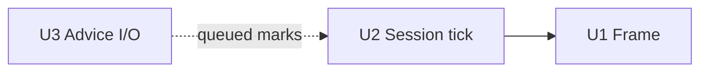

# Concurrency

Authoring rules: [`.agents/specs/rules/technical/concurrency.md`](../../.agents/specs/rules/technical/concurrency.md).

- **Serves**: Instant play; Performance 60 fps; Advice never blocks moves ([F-move-advice.R6](../design/features/move-advice.md))
- **Informed by**: [ADR-0001](../adr/decisions/0001-godot-engine.md), [ADR-0002](../adr/decisions/0002-stockfish-advice-backend.md); clocks in Shared game
- **ADRs**: [ADR-0001](../adr/decisions/0001-godot-engine.md), [ADR-0002](../adr/decisions/0002-stockfish-advice-backend.md)

## Update loops

| ID | Loop | Cadence | Runs | Owns |
|----|------|---------|------|------|
| U1 | Frame | Display frame | Presentation render; input sample; piece motion | L1 presentation state |
| U2 | Session tick | Frame or fixed idle | Clock countdown when timed; session orchestration | Shared clocks; session flags |
| U3 | Advice I/O | Async network callbacks | Apply streamed eval/best-move; cancel | Advice overlay fields only |

## Ownership

| ID | Data or resource | Writer | Readers | Rule |
|----|------------------|--------|---------|------|
| O1 | [`SCH-play-state`](schemata/play-state.md) position and turn | [`CMP-chess-rules`](components/chess-rules.md) via session | Presentation; Advice client | Single writer; Advice never mutates position |
| O2 | Clocks | [`CMP-shared-game-session`](components/shared-game-session.md) | Presentation | Only side-to-move clock runs |
| O3 | Advice best-move / eval | [`CMP-advice-client`](components/advice-client.md) | Presentation | Cleared on move/end/Off/offline |
| O4 | Persist document | [`CMP-persist-store`](components/persist-store.md) | Session router; puzzle session | Whole-document replace |

## Synchronization

| ID | Mechanism | Between | Purpose |
|----|-----------|---------|---------|
| S1 | Queue advice updates onto U1/U2 | U3 → session | Apply marks without hitching the move path |
| S2 | Cancel in-flight advice on local move | apply-local-move → U3 | Instant play; start new eval if still allowed |

## Diagram

