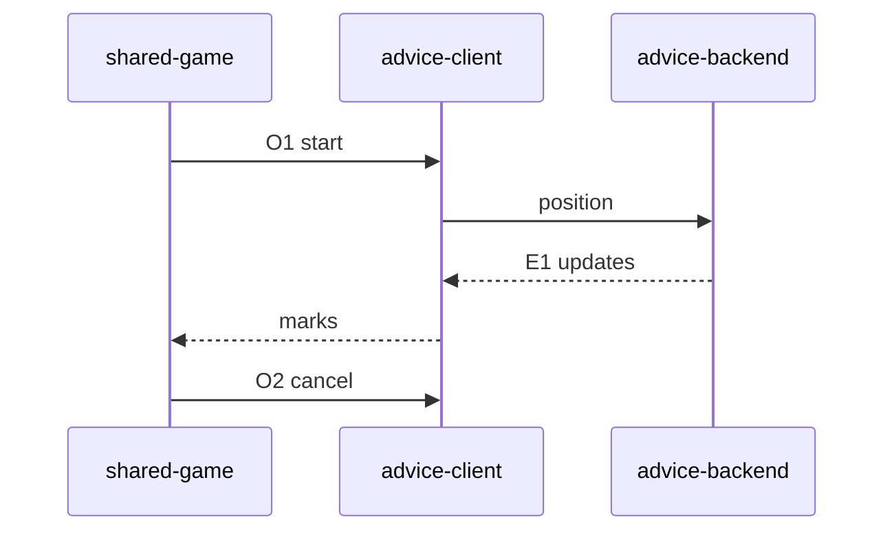

# Contract: Advice stream

Authoring rules: [`.agents/specs/rules/technical/contracts.md`](../../../.agents/specs/rules/technical/contracts.md).

- **Kind**: message — streamed eval/best-move
- **Provider**: advice-backend (M2); client façade [`CMP-advice-client`](../components/advice-client.md)
- **Consumers**: [`CMP-shared-game-session`](../components/shared-game-session.md); presentation via session state
- **Serves**: F-move-advice; Load time advice ≤2000 ms; Instant play
- **Informed by**: [F-move-advice](../../design/features/move-advice.md); `CFG.ADVICE_TIME_MS`
- **ADRs**: [ADR-0002](../../adr/decisions/0002-stockfish-advice-backend.md)

## Operations

| ID | Name | Input | Output / effect | When |
|----|------|-------|-----------------|------|
| O1 | start | position + side to move | Opens stream until cap | Advice On and online in Shared |
| O2 | cancel | — | Stops stream; clears client marks | Move, end, Off, offline, leave |
| O3 | clear | — | Clears best-move/eval fields | With O2 or failure |

## Events

| ID | Name | Payload | When emitted | Who may subscribe |
|----|------|---------|--------------|-------------------|
| E1 | advice_update | best move + eval (White cp) | Stream tick from backend | Advice client → session |
| E2 | advice_ended | reason (cap / cancel / error) | Stream stops | Session |

Wire field names: TBD — exact JSON/protobuf keys for position and updates?

## Guarantees

| ID | Guarantee |
|----|-----------|
| G1 | Local move path never awaits O1/E1 |
| G2 | Backend search stops by `CFG.ADVICE_TIME_MS` (2000) |
| G3 | Client never opens UCI to Stockfish |

## Errors

| Condition | Result |
|-----------|--------|
| Offline / backend error | O3; [`FAIL.T1`](../failures.md) |
| Stale update after cancel | Drop |

## Diagram

