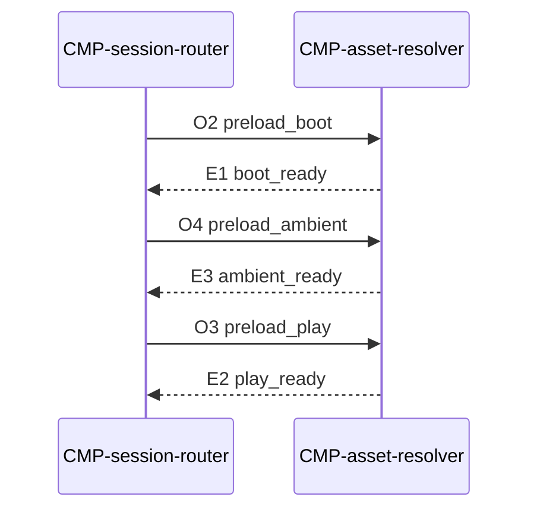

# Contract: Asset resolve

Authoring rules: [`.agents/specs/rules/technical/contracts.md`](../../../.agents/specs/rules/technical/contracts.md).

- **Kind**: API — resolve and preload by asset ID
- **Provider**: [`CMP-asset-resolver`](../components/asset-resolver.md)
- **Consumers**: [`CMP-session-router`](../components/session-router.md) (L2 routes L1 asset needs)
- **Serves**: Load time; [`ACC`](../../assets/access.md) G1 G2 G3; Instant play
- **Informed by**: [`asset-access.md`](../asset-access.md); [`specs/assets/access.md`](../../assets/access.md)
- **ADRs**: [ADR-0005](../../adr/decisions/0005-asset-catalog-roots.md), [ADR-0001](../../adr/decisions/0001-godot-engine.md)

## Operations

| ID | Name | Input | Output / effect | When |
|----|------|-------|-----------------|------|
| O1 | resolve | asset ID | Loaded engine resource or unresolved | Draw / play needs asset |
| O2 | preload_boot | Boot ID set | Boot group ready | Cold open ([`AST.G1`](../asset-access.md)) |
| O3 | preload_play | Play ID set | Play group ready | First Shared/Puzzle play ([`AST.G2`](../asset-access.md)) |
| O4 | preload_ambient | Ambient ID set | Ambient group ready | Mode pick becomes ready (`EX.loading` → ready, after boot ready); not on cold open ([`AST.G3`](../asset-access.md)) |

## Events

| ID | Name | Payload | When emitted | Who may subscribe |
|----|------|---------|--------------|-------------------|
| E1 | boot_ready | — | O2 complete | Session router |
| E2 | play_ready | — | O3 complete | Session router (relays to L1 via [`CTR-presentation`](presentation.md) E5) |
| E3 | ambient_ready | — | O4 complete | Session router |

## Guarantees

| ID | Guarantee |
|----|-----------|
| G1 | Callers use asset IDs only; no hard-coded `game_assets/` paths |
| G2 | Manifest is read-only to runtime; never hand-edited |
| G3 | Unresolved IDs follow [`AST.R3`](../asset-access.md) |
| G4 | L1 never calls this contract; asset needs route through L2 (ADR-0006) |
| G5 | Approved Opus files stay in the asset root; resolve returns the Vorbis copy ([`AST.O3`](../asset-access.md)) |

## Errors

| Condition | Result |
|-----------|--------|
| Unknown ID / load fail | Unresolved path per AST.R3; [`FAIL.T4`](../failures.md) |
| Preload leaves an approved ID unresolved | Group stays not ready; ready event withheld; that ID still follows AST.R3 |

## Diagram

Boot, then Ambient when mode pick becomes ready, then Play on first play entry.

