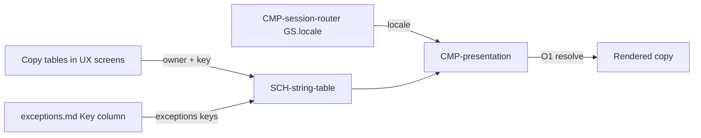

# Contract: Localization

Authoring rules: [`.agents/specs/rules/technical/contracts.md`](../../../.agents/specs/rules/technical/contracts.md).

- **Kind**: API — resolve player-facing copy by owner, key, and locale
- **Provider**: [`CMP-presentation`](../components/presentation.md)
- **Consumers**: [`CMP-presentation`](../components/presentation.md) (the renderer); developers adding or translating copy against a screen Copy table
- **Serves**: [quality.md](../../definition/quality.md) Localization; [Localization copy](../../ux/localization.md)
- **Informed by**: [`SCH-string-table`](../schemata/string-table.md); [`configuration.md`](../configuration.md) S4 B4; [ADR-0001](../../adr/decisions/0001-godot-engine.md)
- **ADRs**: [ADR-0001](../../adr/decisions/0001-godot-engine.md)

## Operations

| ID | Name | Input | Output / effect | When |
|----|------|-------|-----------------|------|
| O1 | resolve | owner id, key, locale | The F5 value; a miss follows Errors | Rendering copy for the current `GS.locale` |
| O2 | switch_locale | next locale | `GS.locale` becomes the next shipped locale in `en` → `zh-Hant` → `ja` → `en`; every visible string re-resolves; no reload | `UI-mode-pick.C4` activated |
| O3 | own_name | locale | The locale's own name (`English`, `繁體中文`, `日本語`), same in every locale | `UI-mode-pick.C4` label |

## Events

None — copy is pulled at render, not pushed.

## Guarantees

| ID | Guarantee |
|----|-----------|
| G1 | Owner ids and keys are the Copy-table Key columns of [`specs/ux/screens/`](../../ux/screens/), plus the Key column of [`exceptions.md`](../../ux/exceptions.md) for the `exceptions` owner, following [Localization copy](../../ux/localization.md) L1 L2. A developer invents no key. |
| G2 | `en` is the source: it is complete first, and `zh-Hant` and `ja` are complete against it ([`SCH-string-table`](../schemata/string-table.md) I1 I2). |
| G3 | O1 is synchronous and on-device; it never awaits network (Instant play, [`CTR-presentation`](presentation.md) G1). |
| G4 | A resolved value never contains a raw key. A miss degrades to `en` and is logged once per owner and key ([`FAIL.T13`](../failures.md), Observability). |
| G5 | Layout tolerates up to 40% width growth versus `en` ([quality.md](../../definition/quality.md) Localization), checked in every state a screen can show. |

## Errors

| Condition | Result |
|-----------|--------|
| Unshipped locale requested | Read `en` ([`configuration.md`](../configuration.md) B4) |
| Key missing in `zh-Hant` or `ja` | Show the `en` value; log once per owner and key; `FAIL.T13` |
| Key missing in `en` | Show the owner-and-key identifier; log; `FAIL.T13` — this is a build defect, not player-facing wording |

## Diagram

