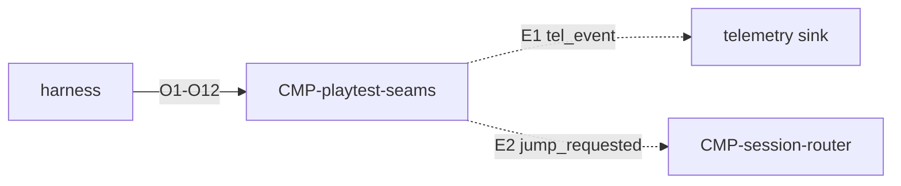

# Contract: Playtest drive

Authoring rules: [`.agents/specs/rules/technical/contracts.md`](../../../.agents/specs/rules/technical/contracts.md).

- **Kind**: API — drive and observe playtest sessions
- **Provider**: [`CMP-playtest-seams`](../components/playtest-seams.md)
- **Consumers**: Playtest harness / agent (`ENV.1` `ENV.2`); [`CMP-session-router`](../components/session-router.md) subscribes E2
- **Serves**: Must `DBG.*` `TEL.*`; cited `SIT.1`–`SIT.6`; Observability; Performance; Load time; Accessibility
- **Informed by**: [`specs/playtest/tools.md`](../../playtest/tools.md); [`verification.md`](../verification.md)
- **ADRs**: [ADR-0004](../../adr/decisions/0004-dual-playtest-environments.md)

## Operations

| ID | Name | Input | Output / effect | When |
|----|------|-------|-----------------|------|
| O1 | pause | — | Halt session clocks/input without ending | `DBG.1` |
| O2 | resume | — | Continue session | `DBG.1` |
| O3 | inspect | field keys | Snapshot of requested play-state fields | `DBG.2` |
| O4 | jump | scenario/stage id | Publishes E2; the router enters that start state | `DBG.3` |
| O5 | set_overlay | on/off + story ids | Show/hide story-ID overlay | `DBG.4` |
| O6 | set_seed | seed | Repeatable start state | `SIT.1` on playtest builds (`ENV.1`, `ENV.2`) |
| O7 | record_input | on/off | Capture the input sequence | `SIT.2` on playtest builds |
| O8 | replay_input | recorded sequence | Play that sequence back | `SIT.2` on playtest builds |
| O9 | dump_state | — | Full state snapshot beyond O3 | `SIT.3` on playtest builds |
| O10 | measure | `frame_times` over a move, or `loading_ready` span | Timing report: samples, max, and the start/end events | `SIT.4` on playtest builds |
| O11 | assert_telemetry | expected story IDs and outcomes | Verdict plus the matched `TEL.*` events | `SIT.5` over the E1 sink |
| O12 | set_viewport | width, height, text scale | Rendered session at that viewport | `SIT.6` on `ENV.2` |

## Events

| ID | Name | Payload | When emitted | Who may subscribe |
|----|------|---------|--------------|-------------------|
| E1 | tel_event | `TEL.1–5` fields | Playtest-relevant outcomes | Harness sink |
| E2 | jump_requested | scenario/stage id | O4 called | Session router (D5–D6) |

## Guarantees

| ID | Guarantee |
|----|-----------|
| G1 | O1–O12 and E1 available in playtest builds on Headless (`ENV.1`) and Graphical (`ENV.2`) |
| G2 | Release Web export starts at `main_release.tscn`, which carries no seam node, so O1–O12, E1, and the story-ID overlay are absent |
| G3 | Drive path must not redefine the 60 fps player move path |

## Errors

| Condition | Result |
|-----------|--------|
| Called in release | No-op / compile-out ([`FAIL.T5`](../failures.md)) |
| Unknown jump id | Error to harness; state unchanged |

## Diagram

