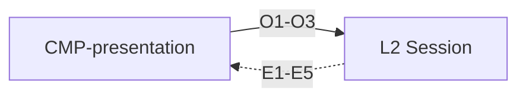

# Contract: Presentation

Authoring rules: [`.agents/specs/rules/technical/contracts.md`](../../../.agents/specs/rules/technical/contracts.md).

- **Kind**: API — render and input surface between L1 and L2
- **Provider**: Any in L2 Session ([`CMP-session-router`](../components/session-router.md), [`CMP-shared-game-session`](../components/shared-game-session.md), [`CMP-puzzle-session`](../components/puzzle-session.md))
- **Consumers**: [`CMP-presentation`](../components/presentation.md)
- **Serves**: Clear board; Cafe calm; Instant play; UX screens
- **Informed by**: [`specs/ux/navigation.md`](../../ux/navigation.md); [`specs/view/cameras/board.md`](../../view/cameras/board.md); [`layers.md`](../layers.md) D1 D4 D5
- **ADRs**: [ADR-0001](../../adr/decisions/0001-godot-engine.md), [ADR-0006](../../adr/decisions/0006-layered-client-architecture.md)

## Operations

| ID | Name | Input | Output / effect | When |
|----|------|-------|-----------------|------|
| O1 | input_commit | from/to (+ promotion) | Forwarded to the active session | Completed select/place gesture |
| O2 | control_activate | screen + control id | Forwarded to router or active session | Tap on an available control |
| O3 | asset_needed | asset ID set | Session resolves via [`CTR-asset-resolve`](asset-resolve.md); returns via E5 | Draw or play needs an unresolved ID |

## Events

| ID | Name | Payload | When emitted | Who may subscribe |
|----|------|---------|--------------|-------------------|
| E1 | show_screen | screen id + state | Navigation | [`CMP-presentation`](../components/presentation.md) |
| E2 | render_position | position, selection, marks | After apply or deal | [`CMP-presentation`](../components/presentation.md) |
| E3 | play_cue | cue id | Design feedback; first music start when mode pick becomes ready (BED_M1/M2 → M1→M2→M1) | [`CMP-presentation`](../components/presentation.md) |
| E4 | show_advice | best move + eval, or none | Advice fields change | [`CMP-presentation`](../components/presentation.md) |
| E5 | provide_assets | resolved resources by asset ID | After L2 resolves via [`CTR-asset-resolve`](asset-resolve.md) | [`CMP-presentation`](../components/presentation.md) |
| E6 | reload_requested | — | The player activated the `EX.load-failure` Reload control (`UI-mode-pick.C5`) | [`CMP-presentation`](../components/presentation.md) → [`CMP-session-router`](../components/session-router.md) |

## Guarantees

| ID | Guarantee |
|----|-----------|
| G1 | E2 and E3 handling completes on-device; neither awaits network (Instant play) |
| G2 | L1 decides no rules outcome; O1–O3 carry input only |
| G3 | L1 never calls L4: asset needs go down as O3 and return as E5 |

## Errors

| Condition | Result |
|-----------|--------|
| Unknown screen or control id | Ignored; no state change |
| Unresolved asset | Degraded visuals per [`AST.R3`](../asset-access.md) |
| Boot preload failed ([`CTR-asset-resolve`](asset-resolve.md) E4) | The router shows `EX.load-failure` in place of `EX.loading`; E1 names it. The wait never outlives the failure ([`FAIL.T15`](../failures.md)) |

## Diagram

