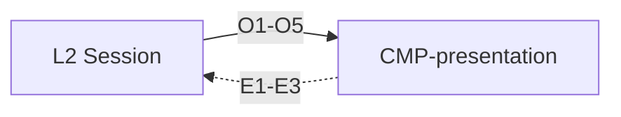

# Contract: Presentation

Authoring rules: [`.agents/specs/rules/technical/contracts.md`](../../../.agents/specs/rules/technical/contracts.md).

- **Kind**: API — render and input surface between L2 and L1
- **Provider**: [`CMP-presentation`](../components/presentation.md)
- **Consumers**: Any in L2 Session — [`CMP-session-router`](../components/session-router.md), [`CMP-shared-game-session`](../components/shared-game-session.md), [`CMP-puzzle-session`](../components/puzzle-session.md)
- **Serves**: Clear board; Cafe calm; Instant play; UX screens
- **Informed by**: [`specs/ux/navigation.md`](../../ux/navigation.md); [`specs/view/cameras/board.md`](../../view/cameras/board.md); [`layers.md`](../layers.md) D1 D5
- **ADRs**: [ADR-0001](../../adr/decisions/0001-godot-engine.md), [ADR-0006](../../adr/decisions/0006-layered-client-architecture.md)

## Operations

| ID | Name | Input | Output / effect | When |
|----|------|-------|-----------------|------|
| O1 | show_screen | screen id + state | That screen and state rendered | Navigation |
| O2 | render_position | position, selection, marks | Board and status updated | After apply or deal |
| O3 | play_cue | cue id | That SFX played, or Ambient playlist started (BED_M1/M2 → M1→M2→M1) | Design feedback event; first music start after board playable |
| O4 | show_advice | best move + eval, or none | Advice marks shown or cleared | Advice fields change |
| O5 | provide_assets | resolved resources by asset ID | Assets bound for draw and play | After L2 resolves via [`CTR-asset-resolve`](asset-resolve.md) |

## Events

| ID | Name | Payload | When emitted | Who may subscribe |
|----|------|---------|--------------|-------------------|
| E1 | input_commit | from/to (+ promotion) | Completed select/place gesture | Active session |
| E2 | control_activate | screen + control id | Tap on an available control | Session router; active session |
| E3 | asset_needed | asset ID set | Draw or play needs an unresolved ID | Session router |

## Guarantees

| ID | Guarantee |
|----|-----------|
| G1 | O2 and O3 complete on-device; neither awaits network (Instant play) |
| G2 | L1 decides no rules outcome; E1–E3 carry input only |
| G3 | L1 never calls L4: asset needs rise as E3 and return as O5 |

## Errors

| Condition | Result |
|-----------|--------|
| Unknown screen or control id | Ignored; no state change ([`FAIL.T4`](../failures.md)) |
| Unresolved asset | Degraded visuals per [`AST.R3`](../asset-access.md) |

## Diagram

