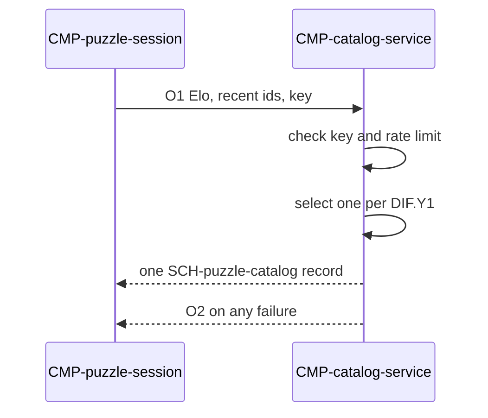

# Contract: Puzzle catalog read

Authoring rules: [`.agents/specs/rules/technical/contracts.md`](../../../.agents/specs/rules/technical/contracts.md).

- **Kind**: message — one-puzzle deal request and response
- **Provider**: [`CMP-catalog-service`](../components/catalog-service.md)
- **Consumers**: [`CMP-puzzle-session`](../components/puzzle-session.md)
- **Serves**: Puzzle stream; [`F-puzzle-catalog`](../../design/features/puzzle-catalog.md) I1 X2; Performance; Reliability
- **Informed by**: [`F-puzzle-catalog`](../../design/features/puzzle-catalog.md) I1 X2; [DIF.Y1](../../design/difficulty.md); [`SCH-puzzle-catalog`](../schemata/puzzle-catalog.md) F1–F13
- **ADRs**: [ADR-0008](../../adr/decisions/0008-puzzle-catalog-storage.md), [ADR-0010](../../adr/decisions/0010-advice-backend-stack.md), [ADR-0013](../../adr/decisions/0013-puzzle-catalog-api.md)

## Operations

| ID | Name | Input | Output / effect | When |
|----|------|-------|-----------------|------|
| O1 | deal | player Elo, recent solved ids, API key | Exactly one [`SCH-puzzle-catalog`](../schemata/puzzle-catalog.md) F1–F13 record | A deal is due in Puzzle stream |
| O2 | refuse | — | No record; no deal | Any failed read (see Errors) |

There is no list, page, or file operation. O1 returns one record or fails; the server never sends a candidate set.

## Events

None — a deal is a request and its single response.

## Guarantees

| ID | Guarantee |
|----|-----------|
| G1 | A success body is exactly one F1–F13 record, never an array, page, or the export file |
| G2 | Selection per [DIF.Y1](../../design/difficulty.md) runs on the server; the client receives no candidate set |
| G3 | The route is asynchronous off the move path; the board stays playable while a deal is in flight |
| G4 | The API key is the configured advice key ([ADR-0010](../../adr/decisions/0010-advice-backend-stack.md); `configuration.md` T10); no second credential |
| G5 | The served snapshot, its records, and snapshot_id are immutable (L2–L3); no in-place edit or export |
| G6 | Every request carries `GS.playerElo`, at most `CFG.ELO_RECENT_WINDOW` recent ids, and the key, and asks for at most one deal at a time |

## Errors

| Condition | Result |
|-----------|--------|
| Missing or wrong key | O2; nothing dealt; `GS.puzzleId` stays none; `GS.playerElo` unchanged (`F-puzzle-catalog` X2) |
| More than 30 requests per key in one minute | O2; refuse; same effect as a missing key |
| Network error, timeout, or non-success status | O2; same effect; the caller deals nothing |
| Bulk body (list, page, or file) | O2; treated as a failed read |
| A record missing or malforming any F1–F13 field | O2; treated as a failed read |

Any failure leaves the prior open puzzle's state untouched and never blocks the stream.

## Diagram

