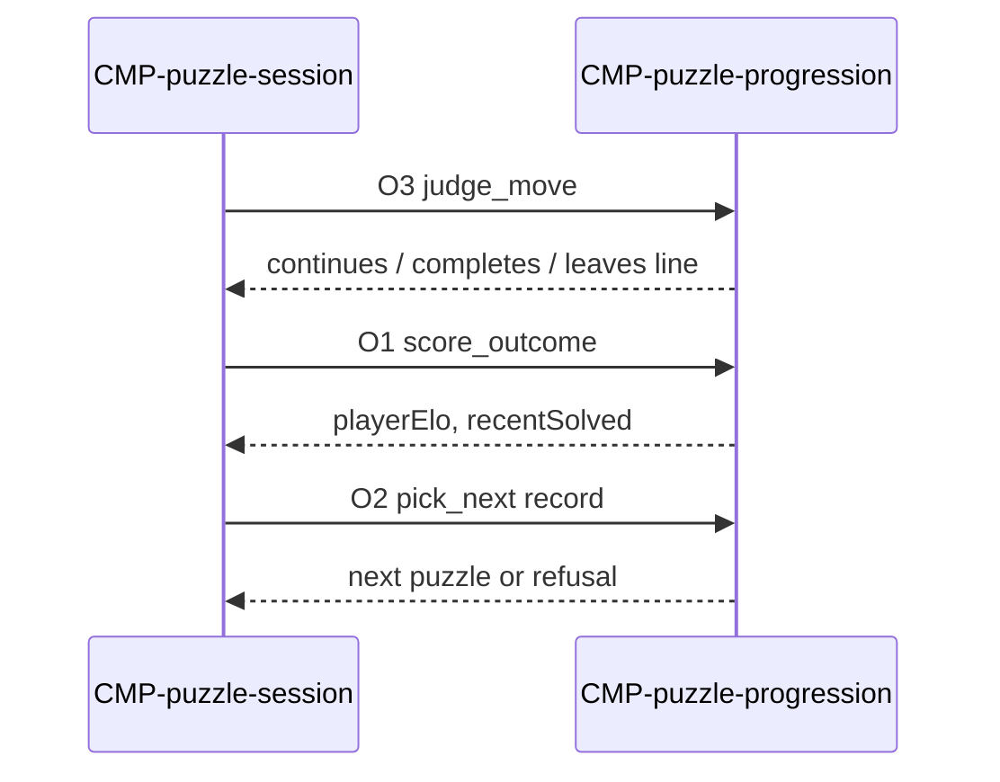

# Contract: Puzzle progress

Authoring rules: [`.agents/specs/rules/technical/contracts.md`](../../../.agents/specs/rules/technical/contracts.md).

- **Kind**: API — Elo, recent-solved, pick, and sequence policy for one puzzle attempt
- **Provider**: [`CMP-puzzle-progression`](../components/puzzle-progression.md)
- **Consumers**: [`CMP-puzzle-session`](../components/puzzle-session.md)
- **Serves**: Puzzle stream; DIF `Y1`; PRG `A1` `P1` `P3` `M1`; [`F-puzzle-catalog`](../../design/features/puzzle-catalog.md) I1
- **Informed by**: [DIF](../../design/difficulty.md) `Y1`; [PRG](../../design/progression.md); end-conditions W1 L4 L5 L6; [`SCH-puzzle-attempt`](../schemata/puzzle-attempt.md); [`SCH-persist-doc`](../schemata/persist-doc.md) F2 F4
- **ADRs**: [ADR-0001](../../adr/decisions/0001-godot-engine.md), [ADR-0006](../../adr/decisions/0006-layered-client-architecture.md)

## Operations

| ID | Name | Input | Output / effect | When |
|----|------|-------|-----------------|------|
| O1 | score_outcome | outcome (`END.W1` / `END.L4` / `END.L5` / `END.L6`), puzzle id, puzzle Elo | Next `GS.playerElo` and `GS.recentSolved`, both updated in Domain (R1–R3) | The session sees a scored ending on the open attempt |
| O2 | pick_next | one or more [`SCH-puzzle-catalog`](../schemata/puzzle-catalog.md) F1–F13 records offered by a deal | The record as the next attempt's puzzle, or a refusal | A deal is due and the stream holds records to offer. The release read returns one ([`CTR-puzzle-catalog-read`](puzzle-catalog-read.md) G1); a larger offer, as in the offline and test paths, runs the full ladder |
| O3 | judge_move | played move, current attempt prefix | Sequence position after the move: continues, completes, or leaves the required line | The session is about to judge a puzzle move via [`CTR-local-move`](local-move.md) O1 |

Session state (`GS.puzzleId`, `GS.puzzleElo`, `GS.requiredSequence`, `GS.sequenceIndex`, `GS.wrongMoveOnPuzzle`) is session-owned ([`CON.O5`](../concurrency.md)); these operations return the value the session writes.

## Events

None — request and response.

## Guarantees

| ID | Guarantee |
|----|-----------|
| G1 | `GS.playerElo` changes only through O1, only on a scored ending of the open attempt, never on a Shared-game ending or on leaving the stream ([`DIF.C1`](../../design/difficulty.md), [`PRG.P1`](../../design/progression.md)) |
| G2 | O1 and O2 are synchronous and on-device ([`LAY.L3`](../layers.md)); no I/O, no await |
| G3 | O2 selects per `DIF.Y1` `Y1` (band and recent window, then the band widened to full reach before a recent id is allowed, then widened again) against the values O1 last produced, or refuses; it never mutates a catalog F1–F13 record. The same policy runs on the host for the served snapshot ([`CMP-catalog-service`](../components/catalog-service.md) R2), so a one-record offer is accepted or refused, never re-ranked |
| G4 | O3 reads only the attempt's required sequence and prefix; it never mutates position ([`SCH-play-state.I1`](../schemata/play-state.md)) |

## Errors

| Condition | Result |
|-----------|--------|
| Outcome outside the scored set (e.g. leaving the stream, `FL-mode-pick.T4`) | No O1; both values unchanged |
| O1 after the attempt already scored | No O1; repeated scoring is refused |
| O2 with no candidate after the full relax | Refusal; the session deals nothing ([`FAIL.T14`](../failures.md)) |
| O3 on a move outside the required line | Leaves the required line; the session marks the attempt failed per `END.L4` |

## Diagram

