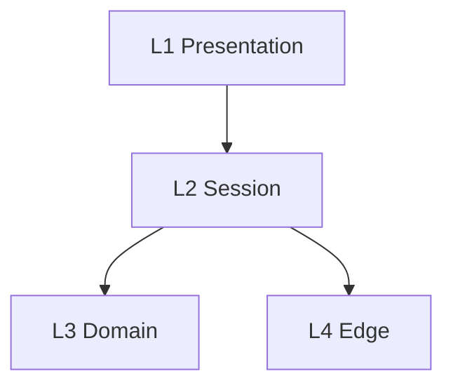

# Layers

Authoring rules: [`.agents/specs/rules/technical/layers.md`](../../.agents/specs/rules/technical/layers.md).

- **Serves**: Instant play; Shared game; Puzzle stream; optional Advice; cafe Presentation
- **Informed by**: [ADR-0001](../adr/decisions/0001-godot-engine.md), [ADR-0002](../adr/decisions/0002-stockfish-advice-backend.md), [ADR-0003](../adr/decisions/0003-localstorage-persistence.md), [ADR-0004](../adr/decisions/0004-dual-playtest-environments.md), [ADR-0005](../adr/decisions/0005-asset-catalog-roots.md), [ADR-0006](../adr/decisions/0006-layered-client-architecture.md); design; view; UX

## Layers

| ID | Name | Responsibility | May depend on |
|----|------|----------------|---------------|
| L1 | Presentation | Board, UI, touch input, SFX/music playback | L2 |
| L2 | Session | Mode pick; Shared game and Puzzle stream orchestration; clocks | L3, L4 |
| L3 | Domain | Chess legality, end conditions, Elo and puzzle pick ([`CMP-puzzle-progression`](components/puzzle-progression.md)) | none |
| L4 | Edge | Persist, Advice client, Asset resolver, playtest seams | none (external I/O; subscribes to contract events per D5–D6) |

The advice backend (Stockfish UCI peer) is outside this client stack ([ADR-0002](../adr/decisions/0002-stockfish-advice-backend.md)); L4 Advice client is the only client caller.

## Dependency rules

| ID | Rule |
|----|------|
| D1 | Allowed edges: L1→L2, L2→L3, L2→L4 only. No upward or skip-layer imports. |
| D2 | L3 Domain never references L1, L2, or L4 types; sessions call Domain via contracts, such as [`CTR-puzzle-progress`](contracts/puzzle-progress.md). |
| D3 | L4 adapters implement ports; Domain and Session depend on contract shapes, not storage or HTTP types. |
| D4 | Cycles forbidden; review fails any bidirectional layer import. |
| D5 | Upward flow is contract events only — inner publishes, outer subscribes (e.g. L2 publishes `CTR-presentation` E1–E5; L3 publishes `CTR-local-move` E1–E2). Not an import, so D1 and D4 still hold; Presentation→Session stays L1→L2 only. |
| D6 | Playtest builds only: `CMP-playtest-seams` observes L2/L1 and publishes drive events on `CTR-playtest-drive`; stripped or no-op in release (ADR-0004). |

## Diagram

