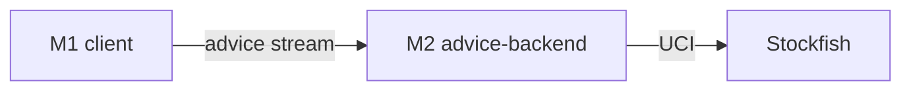

# Modules

Authoring rules: [`.agents/specs/rules/technical/modules.md`](../../.agents/specs/rules/technical/modules.md).

- **Serves**: Instant play; Web ship; Advice without client Stockfish
- **Informed by**: [ADR-0001](../adr/decisions/0001-godot-engine.md), [ADR-0002](../adr/decisions/0002-stockfish-advice-backend.md), [ADR-0004](../adr/decisions/0004-dual-playtest-environments.md), [ADR-0006](../adr/decisions/0006-layered-client-architecture.md)

## Modules

| ID | Name | Contains | Boundary rule |
|----|------|----------|---------------|
| M1 | `client` | Godot 4.7.2 Web app under `game/`: all L1–L4 components; playtest build flags | No Stockfish; no UCI |
| M2 | `advice-backend` | Server process: sole UCI peer to Stockfish; streams eval/best-move to M1 | Client never imports engine |

Godot project root: `game/` at the repo root (sibling of `asset_catalog/`, `game_assets/`, `specs/`) ([ADR-0001](../adr/decisions/0001-godot-engine.md)).

## Boundaries

| ID | From | To | Allowed | Forbidden |
|----|------|----|---------|-----------|
| B1 | M1 | M2 | Position request; streamed advice until `CFG.ADVICE_TIME_MS`; cancel | Direct Stockfish or UCI |
| B2 | M2 | Stockfish | UCI only inside M2 | Exposing Stockfish to M1 |
| B3 | M1 | Browser | `localStorage`; Web export APIs | Server-side save ([ADR-0003](../adr/decisions/0003-localstorage-persistence.md)) |

## Diagram

