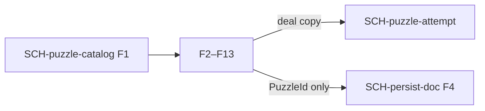

# Schema: Puzzle catalog

Authoring rules: [`.agents/specs/rules/technical/schemata.md`](../../../.agents/specs/rules/technical/schemata.md).

- **Kind**: resource
- **Owner**: Host publish of the snapshot ([ADR-0008](../../adr/decisions/0008-puzzle-catalog-storage.md)). [`CMP-puzzle-session`](../components/puzzle-session.md) reads a dealt record and does not mutate the snapshot.
- **Serves**: Puzzle stream; [`F-puzzle-catalog`](../../design/features/puzzle-catalog.md)
- **Informed by**: [`F-puzzle-catalog`](../../design/features/puzzle-catalog.md) R1–R5, I3, X1; `GS.puzzleId`, `GS.puzzleElo`, `GS.requiredSequence`, `GS.recentSolved`
- **ADRs**: [ADR-0008](../../adr/decisions/0008-puzzle-catalog-storage.md)

## Fields

| ID | Field | Type / shape | Required | Notes |
|----|-------|--------------|----------|-------|
| F1 | snapshot_id | string | yes | `2026-10-05` on every record |
| F2 | puzzle_id | string | yes | Export PuzzleId; `GS.puzzleId`; `GS.recentSolved` |
| F3 | fen | string | yes | Position before the opponent move |
| F4 | moves | string[] | yes | UCI, length ≥ 2; first entry is the opponent move |
| F5 | rating | int | yes | Puzzle Elo; `GS.puzzleElo` |
| F6 | rating_deviation | int | yes | Stored; not used by dealing |
| F7 | popularity | int | yes | Stored; not used by dealing |
| F8 | nb_plays | int | yes | Stored; not used by dealing |
| F9 | themes | string[] | yes | `mateIn1` marks mate in one |
| F10 | game_url | string | yes | Source game; not used by dealing |
| F11 | opening_tags | string | yes | May be empty; not used by dealing |
| F12 | daily_date | string | no | Empty when the puzzle was not a daily |
| F13 | any_checkmate_wins | bool | yes | True iff F9 contains `mateIn1` |

## Invariants

| ID | Invariant |
|----|-----------|
| I1 | The served snapshot has snapshot_id `2026-10-05` and exactly 6,157,341 records |
| I2 | `moves` length ≥ 2, so the derived required sequence has length ≥ 1 |
| I3 | `any_checkmate_wins` is true iff `mateIn1` is in `themes`; then `moves` has length 2 |
| I4 | Records are not embedded in [`SCH-persist-doc`](persist-doc.md) |

## Lifecycle

| ID | Phase | Who | What changes |
|----|-------|-----|--------------|
| L1 | create | Host publish | Snapshot `2026-10-05` and its records become the served catalog |
| L2 | update | Host | No in-place edit; records and snapshot_id stay immutable |
| L3 | destroy | Host | This snapshot stays the served catalog |

## Relationships

| Related schema | Cardinality | Notes |
|----------------|-------------|-------|
| [`SCH-persist-doc`](persist-doc.md) | ids only | `recent_solved` stores F2, not records |
| [`SCH-puzzle-attempt`](puzzle-attempt.md) | one deal | Copies F2, F5, and the derived sequence |

## Diagram

## Persistence

Catalog bytes are not in [`persistence.md`](../persistence.md). [`SAV.M4`](../persistence.md) stores PuzzleId strings of snapshot `2026-10-05` only.
