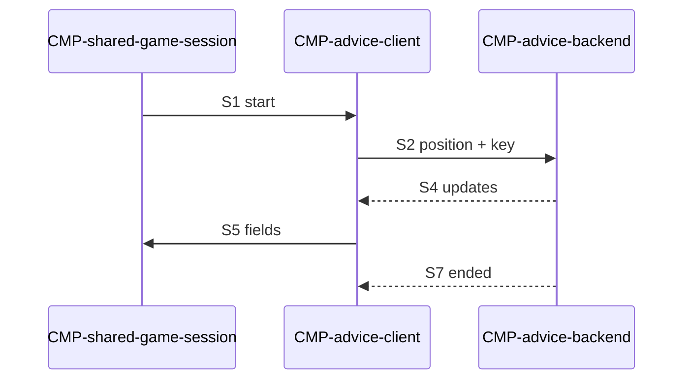

# Sequence: Advice stream

Authoring rules: [`.agents/specs/rules/technical/sequences.md`](../../../.agents/specs/rules/technical/sequences.md).

- **Trigger**: Shared game needs Advice for the side to move (On + online)
- **Participants**: [`CMP-shared-game-session`](../components/shared-game-session.md), [`CMP-advice-client`](../components/advice-client.md), [`CMP-advice-backend`](../components/advice-backend.md), [`CMP-presentation`](../components/presentation.md)
- **Contracts used**: [`CTR-advice-stream`](../contracts/advice-stream.md), [`CTR-presentation`](../contracts/presentation.md)
- **Serves**: F-move-advice; streamed eval to `CFG.ADVICE_TIME_MS`
- **Informed by**: requirement note — server Stockfish, time-capped stream, moves never wait
- **ADRs**: [ADR-0002](../../adr/decisions/0002-stockfish-advice-backend.md), [ADR-0010](../../adr/decisions/0010-advice-backend-stack.md), [ADR-0011](../../adr/decisions/0011-local-stockfish-invocation.md)

## Steps

| ID | From | To | Via | Action / message |
|----|------|----|-----|------------------|
| S1 | shared-game | advice-client | CTR-advice-stream.O1 | start(position) |
| S2 | advice-client | advice-backend | network | Send position and API key to the configured endpoint ([`CFG.T9`](../configuration.md) T9, T10) |
| S3 | advice-backend | Stockfish | Local UCI, same server | Search (M2 only). Not a network hop ([ADR-0011](../../adr/decisions/0011-local-stockfish-invocation.md)) |
| S4 | advice-backend | advice-client | CTR-advice-stream.E1 | Stream updates |
| S5 | advice-client | shared-game | CTR-advice-stream.E1 | Write best-move/eval |
| S6 | shared-game | presentation | CTR-presentation.E4 | Show marks |
| S7 | advice-backend | advice-client | CTR-advice-stream.E2 | End at cap or cancel |

## Branches

| ID | Condition | Next steps | Outcome |
|----|-----------|------------|---------|
| B1 | Offline / error | Fail after S2 | Clear marks; play continues |
| B2 | Local move during stream | [`SEQ-apply-local-move`](apply-local-move.md) S5 | Cancel; optional restart |
| B3 | Advice Off / leave | O2 from session | Clear; stop |

## Postconditions

- Eval/best-move reflect side to move only while R2 holds.
- No step blocks [`SEQ-apply-local-move`](apply-local-move.md).

## Diagram

