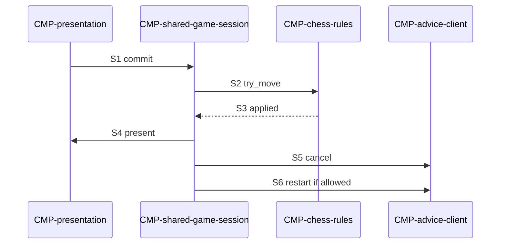

# Sequence: Apply local move

Authoring rules: [`.agents/specs/rules/technical/sequences.md`](../../../.agents/specs/rules/technical/sequences.md).

- **Trigger**: Player commits a move on the shared or puzzle board
- **Participants**: [`CMP-presentation`](../components/presentation.md), [`CMP-shared-game-session`](../components/shared-game-session.md) or [`CMP-puzzle-session`](../components/puzzle-session.md), [`CMP-chess-rules`](../components/chess-rules.md), [`CMP-advice-client`](../components/advice-client.md) (Shared only)
- **Contracts used**: [`CTR-presentation`](../contracts/presentation.md), [`CTR-local-move`](../contracts/local-move.md), [`CTR-advice-stream`](../contracts/advice-stream.md)
- **Serves**: Instant play; F-move-advice.R6 R8
- **Informed by**: Shared / Puzzle loops; end-conditions
- **ADRs**: [ADR-0001](../../adr/decisions/0001-godot-engine.md), [ADR-0002](../../adr/decisions/0002-stockfish-advice-backend.md)

## Steps

| ID | From | To | Via | Action / message |
|----|------|----|-----|------------------|
| S1 | presentation | session | CTR-presentation.E1 | Commit from/to (+ promotion) |
| S2 | session | chess-rules | CTR-local-move.O1 | try_move |
| S3 | chess-rules | session | CTR-local-move.E1 | move_applied |
| S4 | session | presentation | CTR-presentation.O2 O3 | Animate / SFX; update board |
| S5 | session | advice-client | CTR-advice-stream.O2 | cancel + clear (Shared, if any) |
| S6 | session | advice-client | CTR-advice-stream.O1 | start new position if Advice still allowed |

## Branches

| ID | Condition | Next steps | Outcome |
|----|-----------|------------|---------|
| B1 | Illegal | E2 after S2; skip S3–S6 | State unchanged; reject feedback |
| B2 | Puzzle wrong move | After S3 design fail path | No next puzzle deal; per design |
| B3 | Game ended | S3–S5; skip S6 | Clear advice; result flow |
| B4 | Puzzle mode | S1–S4; skip S5–S6 | No advice |

## Postconditions

- Legal move fully applied on-device before any advice round-trip.
- Advice marks never delay S4.

## Diagram

