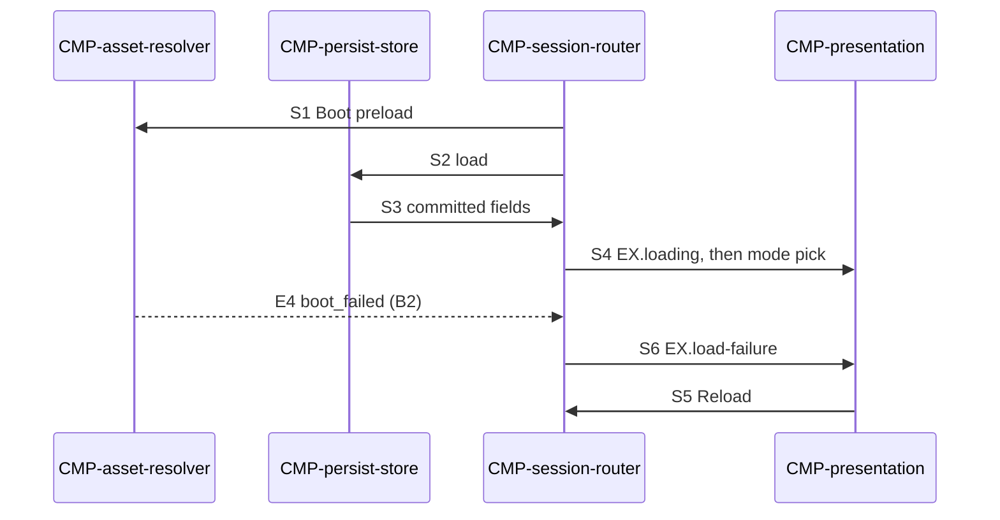

# Sequence: Cold open

Authoring rules: [`.agents/specs/rules/technical/sequences.md`](../../../.agents/specs/rules/technical/sequences.md).

- **Trigger**: Player opens the Web game; [`CMP-session-router`](../components/session-router.md) `R1` fires when Boot assets and persist load complete
- **Participants**: [`CMP-asset-resolver`](../components/asset-resolver.md), [`CMP-persist-store`](../components/persist-store.md), [`CMP-session-router`](../components/session-router.md), [`CMP-presentation`](../components/presentation.md)
- **Contracts used**: [`CTR-asset-resolve`](../contracts/asset-resolve.md), [`CTR-persist-document`](../contracts/persist-document.md), [`CTR-presentation`](../contracts/presentation.md)
- **Serves**: Load time ≤3 s to playable; mode pick
- **Informed by**: quality Load time; [`ACC.G1`](../../assets/access.md)
- **ADRs**: [ADR-0001](../../adr/decisions/0001-godot-engine.md), [ADR-0003](../../adr/decisions/0003-localstorage-persistence.md), [ADR-0005](../../adr/decisions/0005-asset-catalog-roots.md)

## Steps

| ID | From | To | Via | Action / message |
|----|------|----|-----|------------------|
| S1 | session-router | asset-resolver | CTR-asset-resolve.O2 | Preload Boot asset IDs |
| S2 | session-router | persist-store | CTR-persist-document.O1 | Load document or defaults |
| S3 | persist-store | session-router | CTR-persist-document.O1 return | Provide Elo / Last mode |
| S4 | session-router | presentation | CTR-presentation.E1 | Show `EX.loading`, then mode pick when Boot ready |
| S5 | presentation | session-router | CTR-presentation.E6 | Reload activated on `EX.load-failure` |
| S6 | session-router | presentation | CTR-presentation.E1 | Show `EX.load-failure` in place of `EX.loading` |

## Branches

| ID | Condition | Next steps | Outcome |
|----|-----------|------------|---------|
| B1 | Persist corrupt/missing | S2 defaults → S3 → S4 | Mode pick with Elo start |
| B2 | Boot leaves an approved ID unresolved | S1 E4 → S6 → S5 → S1 | `EX.load-failure` replaces `EX.loading`; Reload loads the game again from the start ([`FAIL.T15`](../failures.md)) |

## Postconditions

- Mode pick is interactive without waiting on Advice or Play assets, or `EX.load-failure` names the failed load.
- Committed Elo and Last mode are available to sessions.

## Diagram

