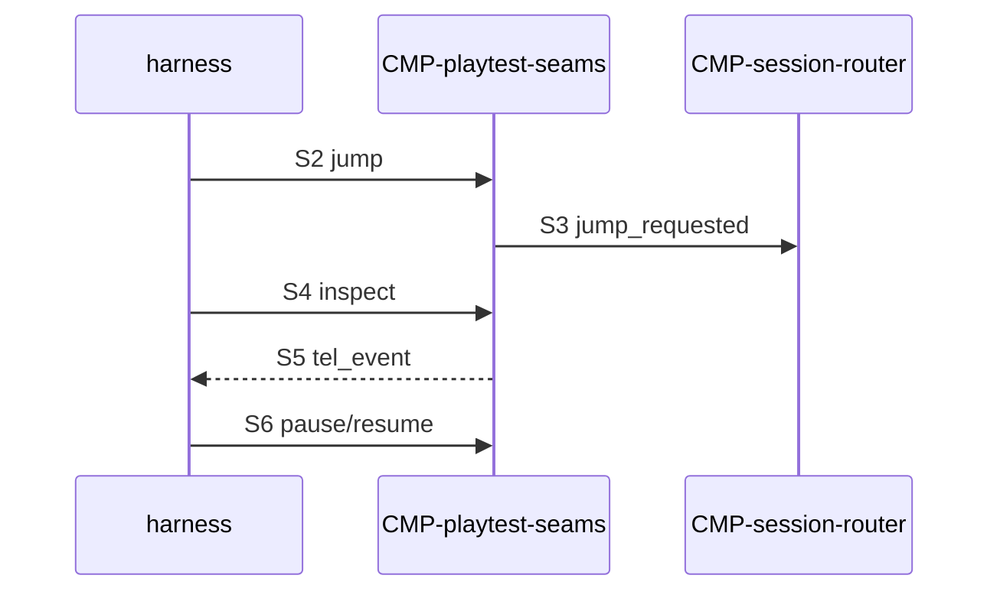

# Sequence: Playtest headless smoke

Authoring rules: [`.agents/specs/rules/technical/sequences.md`](../../../.agents/specs/rules/technical/sequences.md).

- **Trigger**: CI or agent starts a Headless playtest build (`ENV.1`)
- **Participants**: Harness, Godot `--headless`, [`CMP-playtest-seams`](../components/playtest-seams.md), [`CMP-session-router`](../components/session-router.md)
- **Contracts used**: [`CTR-playtest-drive`](../contracts/playtest-drive.md)
- **Serves**: ADR-0004 Headless; verification I4; Observability
- **Informed by**: [`verification.md`](../verification.md) S1 S3–S7; playtest tools
- **ADRs**: [ADR-0004](../../adr/decisions/0004-dual-playtest-environments.md), [ADR-0001](../../adr/decisions/0001-godot-engine.md)

## Steps

| ID | From | To | Via | Action / message |
|----|------|----|-----|------------------|
| S1 | harness | Godot | `--headless` playtest | Launch playtest build |
| S2 | harness | playtest-seams | CTR-playtest-drive.O4 | jump to a named smoke stage |
| S3 | playtest-seams | session-router | CTR-playtest-drive.E2 | Router enters that start state |
| S4 | harness | playtest-seams | CTR-playtest-drive.O3 | inspect key play-state fields |
| S5 | playtest-seams | harness | CTR-playtest-drive.E1 | Emit at least one `tel_event` with story ID when applicable |
| S6 | harness | playtest-seams | CTR-playtest-drive.O1 then O2 | pause then resume |
| S7 | harness | Godot | exit | Session ends without forced crash |

## Branches

| ID | Condition | Next steps | Outcome |
|----|-----------|------------|---------|
| B1 | Jump id unknown | Fail after S2 | Smoke fail; no mutate |
| B2 | Seams missing (release binary) | Fail at S1/S2 | Wrong build; smoke fail |

## Postconditions

- Headless session completed with DBG inspect and TEL emit exercised.
- No requirement for Graphical display.

## Diagram

