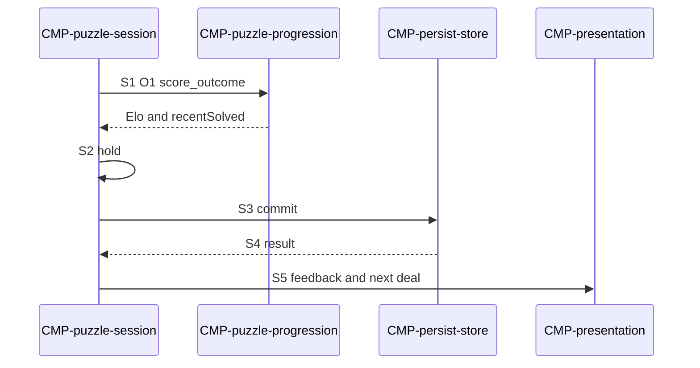

# Sequence: Puzzle result commit

Authoring rules: [`.agents/specs/rules/technical/sequences.md`](../../../.agents/specs/rules/technical/sequences.md).

- **Trigger**: Puzzle attempt reaches solved (W1) or failure (L4 / L5)
- **Participants**: [`CMP-puzzle-session`](../components/puzzle-session.md), [`CMP-puzzle-progression`](../components/puzzle-progression.md), [`CMP-persist-store`](../components/persist-store.md), [`CMP-presentation`](../components/presentation.md)
- **Contracts used**: [`CTR-puzzle-progress`](../contracts/puzzle-progress.md), [`CTR-persist-document`](../contracts/persist-document.md), [`CTR-presentation`](../contracts/presentation.md)
- **Serves**: Save durability; DIF Elo; recent solved ≤20
- **Informed by**: end-conditions W1 L4 L5; [PRG](../../design/progression.md); [`SCH-puzzle-attempt`](../schemata/puzzle-attempt.md)
- **ADRs**: [ADR-0003](../../adr/decisions/0003-localstorage-persistence.md), [ADR-0006](../../adr/decisions/0006-layered-client-architecture.md)

## Steps

| ID | From | To | Via | Action / message |
|----|------|----|-----|------------------|
| S1 | puzzle-session | puzzle-progression | [`CTR-puzzle-progress`](../contracts/puzzle-progress.md) O1 | Domain computes Elo and recentSolved from the outcome (R1–R2); returns both to the session |
| S2 | puzzle-session | puzzle-session | internal | Hold the returned Elo, and the returned recentSolved list (a solved id appended and trimmed to `CFG.ELO_RECENT_WINDOW`) |
| S3 | puzzle-session | persist-store | CTR-persist-document.O2 | commit full document |
| S4 | persist-store | puzzle-session | CTR-persist-document.O2 return | Success or fail signal |
| S5 | puzzle-session | presentation | CTR-presentation.E2 E3 | Feedback; deal next or show fail then next per design |

## Branches

| ID | Condition | Next steps | Outcome |
|----|-----------|------------|---------|
| B1 | Commit success | S5 | Durable Elo / recentSolved updated |
| B2 | Commit fail | S5 with in-memory values; [`FAIL.T2`](../failures.md) | Prior document intact; sitting may diverge |

## Postconditions

- Prior durable document unchanged if S3 failed.
- Attempt outcome recorded in session before next deal; the Elo values stay Domain-owned, and only the commit reaches L4.

## Diagram

