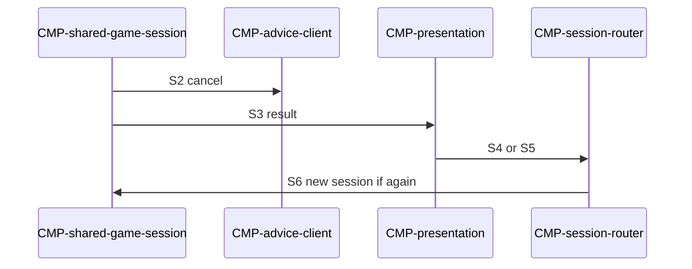

# Sequence: Shared end and new session

Authoring rules: [`.agents/specs/rules/technical/sequences.md`](../../../.agents/specs/rules/technical/sequences.md).

- **Trigger**: Shared game reaches an end condition (`GS.gameEnded`)
- **Participants**: [`CMP-shared-game-session`](../components/shared-game-session.md), [`CMP-chess-rules`](../components/chess-rules.md), [`CMP-advice-client`](../components/advice-client.md), [`CMP-presentation`](../components/presentation.md), [`CMP-session-router`](../components/session-router.md)
- **Contracts used**: [`CTR-local-move`](../contracts/local-move.md), [`CTR-advice-stream`](../contracts/advice-stream.md), [`CTR-presentation`](../contracts/presentation.md)
- **Serves**: Shared result UX; new session after end ([two-player-game K3](../../design/loops/two-player-game.md))
- **Informed by**: end-conditions; UX shared-result
- **ADRs**: [ADR-0001](../../adr/decisions/0001-godot-engine.md), [ADR-0002](../../adr/decisions/0002-stockfish-advice-backend.md)

## Steps

| ID | From | To | Via | Action / message |
|----|------|----|-----|------------------|
| S1 | shared-game | chess-rules | CTR-local-move.O3 | Observe end signal; set game_ended |
| S2 | shared-game | advice-client | CTR-advice-stream.O2 | cancel + clear |
| S3 | shared-game | presentation | CTR-presentation.E1 | Show shared-result |
| S4 | presentation | session-router | CTR-presentation.O2 | Play again → shared-setup |
| S5 | presentation | session-router | CTR-presentation.O2 | Stop → mode-pick |
| S6 | session-router | shared-game | internal | If Play again: new Shared session (setup unlocked) |

## Branches

| ID | Condition | Next steps | Outcome |
|----|-----------|------------|---------|
| B1 | Play again | S4 → S6 | Fresh Shared setup; no Elo change |
| B2 | Stop | S5 | Mode pick; Last mode already committed |

## Postconditions

- Advice cleared before result UI.
- No durable Elo write from Shared end.

## Diagram

